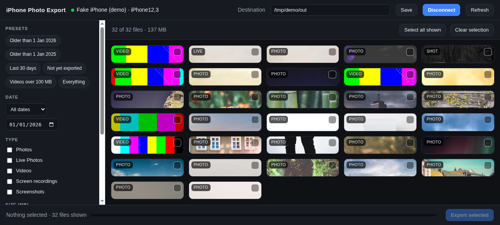
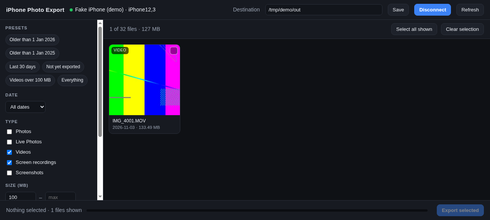
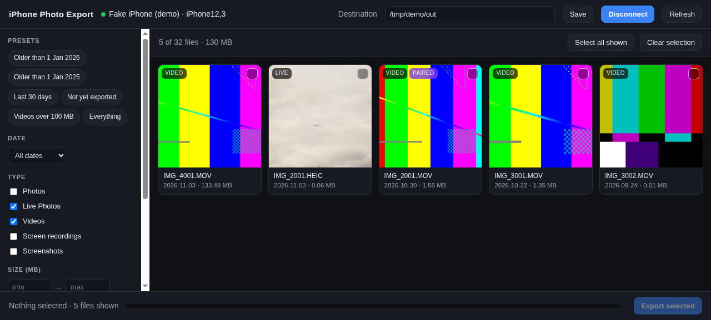
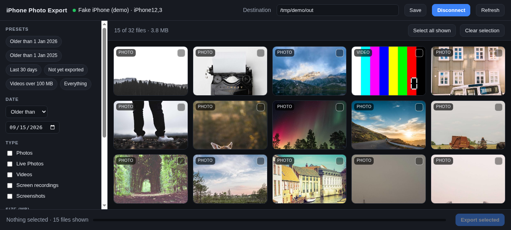
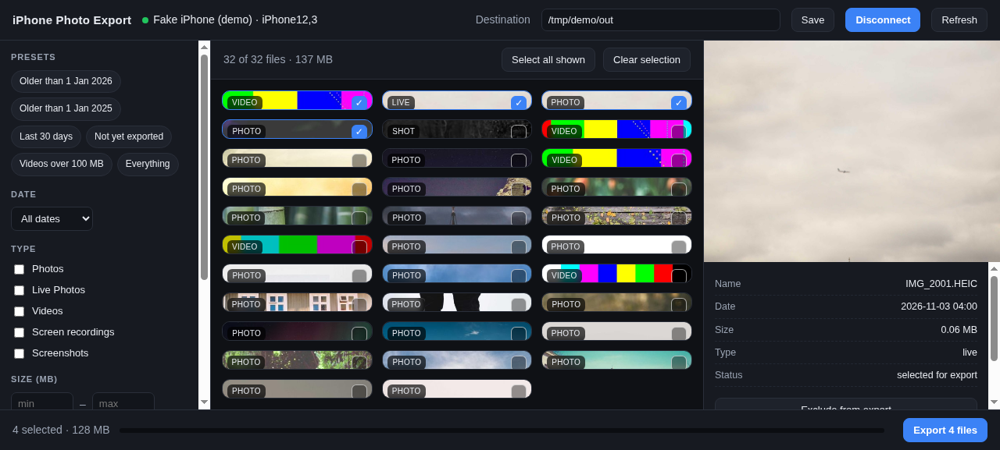
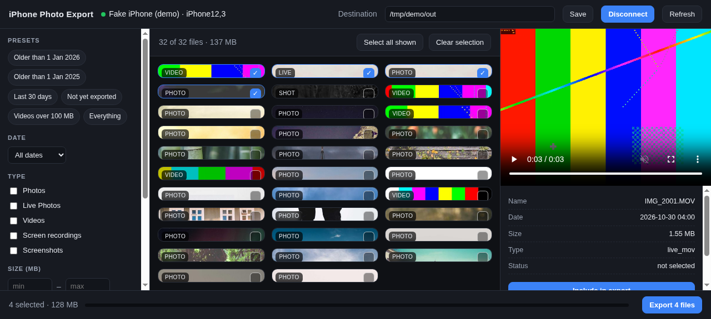
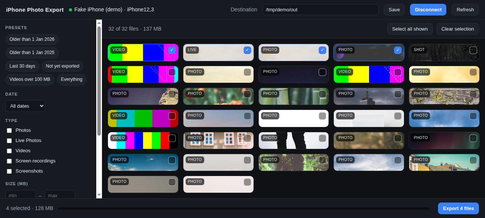
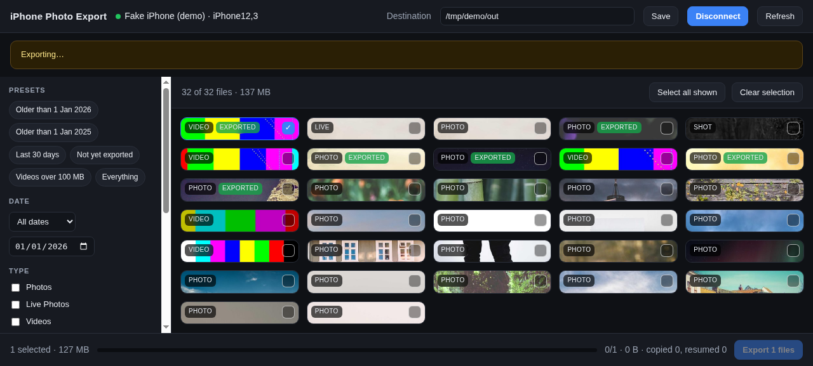
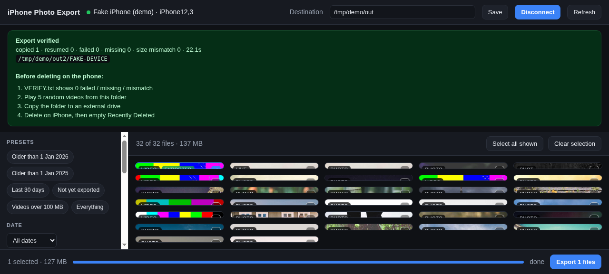

# iPhone Photo Export

**Offload photos and videos from a USB-connected iPhone to a Windows PC — as a normal
installed desktop app, with SHA-256 verification before you delete anything on the phone.**

One 144 MB installer. No Python, no iTunes, no command line, no iCloud. Double-click, plug in
the cable, tap Trust, export.

Read-only on the device: it never deletes, moves or renames anything on the iPhone.
Built for the case where iCloud is on the free 5 GB tier, so the phone holds the only copy.



---

## Why this exists

iCloud's free tier is 5 GB. A 128 GB iPhone fills that in a week, so most people turn iCloud
Photos off — and then the phone becomes a single point of failure holding years of family
photos. Commercial tools work but are subscription-priced, and "just drag DCIM in Explorer"
gives you no proof the copy is complete, which is not good enough to justify deleting the
originals.

This app is the missing middle: free, open source, and built around one question —
**is every single byte actually on the PC now?**

---

## Install (Windows 10/11, 64-bit)

1. Download `iPhonePhotoExport-1.0.1-Setup.exe` from [Releases](../../releases/latest).
2. Run it. Windows asks for administrator rights once, to install Apple's USB device driver.
3. Done — an **iPhone Photo Export** shortcut is on the desktop and in the Start menu.

### What the installer puts on your PC

The single `.exe` contains everything. Nothing is downloaded at install time and no separate
runtime is needed:

| Component | Purpose | Bundled |
|---|---|---|
| Python 3.11 runtime | runs the app | inside the payload |
| Flask + Jinja2 | local web UI | yes |
| pymobiledevice3 | talks to the iPhone over USB (AFC) | yes |
| Pillow + pillow-heif | HEIC/HEIF decoding and thumbnails | yes |
| ffmpeg 9.0 | video poster frames | yes |
| Microsoft WebView2 | native app window | used if present, else falls back to the browser |
| Apple Mobile Device Support | USB driver that makes the iPhone visible | installed silently **only if missing** |
| Your photos | — | never touched |

Apple's driver ships inside the installer as the official `AppleMobileDeviceSupport64.msi`,
extracted from Apple's own iTunes package. It is installed only when the
`Apple Mobile Device Service` is not already present, so machines with iTunes or the Apple
Devices app skip that step. **iTunes itself is not installed** — only the driver.

Installer size is 144 MB: ffmpeg (~100 MB), the Apple driver (34 MB), and the Python payload
(~10 MB after compression).

### Requirements

- Windows 10 (1809+) or Windows 11, 64-bit
- ~450 MB free disk space (install + thumbnail cache)
- The iPhone cable plugged directly into the PC — no hub, no dock, no monitor USB port
- iPhone unlocked, with **Trust** tapped when the prompt appears

### Download

[Latest release](../../releases/latest) · 144 MB · SHA-256
`a7b06a5b110699c7392df7f92895be174a301f7d1302e3ae37c5ba13018ec5a0`

The build is unsigned, so SmartScreen may warn — *More info* > *Run anyway*, and check the hash
above with `certutil -hashfile <file> SHA256`.

---

## Use it

### 1. Connect

Plug the iPhone in, unlock it, tap **Trust**, then press **Connect iPhone**.


The status dot turns green and the camera roll appears; device name, model and iOS version are
read from the phone. If two phones are connected you are asked which one.

### 2. Pick what to export

Everything in the left sidebar is a filter; the grid updates as you change it.

**Presets** — one click for the common jobs:



```
Older than 1 Jan <year>      everything from previous years (the usual "free up space" run)
Older than 1 Jan <year-1>    the year before that
Last 30 days                 just-taken photos, e.g. to hand off
Not yet exported             only files this app has never copied
Videos over 100 MB           the space hogs
Everything                   no filter
```

**Type** — Photos, Live Photos, Videos, Screen recordings, Screenshots:



Live Photos are handled as a pair: the HEIC still and its `.MOV` motion clip share a stem and
are classified together. **Keep Live Photo pairs together** (on by default) re-adds the motion
clip whenever the still matches your filter, so you never split a Live Photo.

**Date** — older than / newer than / between two dates:



**Size** — min/max in MB. **Export status** — any / not yet exported / already exported.
**Filename** — substring search, e.g. `IMG_1234`.

### 3. Review before you commit

Click any card to open the detail drawer. Images preview instantly; a video over 150 MB asks
before pulling the whole file down for playback, so hovering a 4 GB clip never starts a hidden
download.





### 4. Export

Select files by clicking the tick on each card, or **Select all shown**, then **Export N files**.
Nothing is copied until you press that button. **Select all shown** applies to the current
filter, not the whole library.



Progress is per file, with running byte counts:



### 5. Read the result before deleting anything



The app does not just copy — it proves the copy:

- every file is written to a `.part` file, size-checked, then renamed into place
- a full SHA-256 is computed for every file and written to `manifest.csv`
- a verification pass re-checks that every expected file exists at the expected size
- `VERIFY.txt` records copied / resumed / failed / missing / mismatch counts

The export is flagged safe to delete only when failed, missing and mismatch are all zero.

---

## What lands on disk

```
<destination>/
  <device-UDID>/
    DCIM/100APPLE/IMG_1234.HEIC      the originals, folder structure preserved
    DCIM/100APPLE/IMG_1234.MOV
    manifest.csv                     device path, local path, size, mtime, sha256, status
    VERIFY.txt                       human-readable pass/fail summary
```

`manifest.csv` is also how **Not yet exported** and the green *exported* badges work: on every
connect the app reads the manifests already in the destination and marks anything it has seen
before.

### Resume is automatic

Re-run an export into the same folder and files already present at the correct size count as
`resumed` instead of being downloaded again. A file present at the *wrong* size is re-fetched,
so truncated copies heal themselves. On a 100 GB library over USB an interrupted run costs you
only the file that was in flight.

Lightning iPhones typically move 1–3 GB/min, so 100 GB is roughly 1–2 hours.

---

## The safe-delete workflow

The app never deletes anything on the phone. Do this yourself, in order:

1. `VERIFY.txt` shows **0** failed, **0** missing, **0** mismatch.
2. Play 5 random videos from the export folder — catches files that copied but are corrupt.
3. Copy the folder to a **second** drive (the phone was the only copy; now the PC is).
4. Only then delete on the iPhone, and empty **Recently Deleted** (iOS holds files 30 days, so
   the space is not actually freed until you do).
5. Confirm in Settings > General > iPhone Storage.

Delete in batches — a month or a year at a time — and re-check after each batch. Skipping step 3
only moves the single point of failure from the phone to one hard disk.

---

## Command line (optional)

Same engine, for scripted or unattended runs. Installed app path:
`C:\Program Files\iPhone Photo Export\iPhonePhotoExport.exe`.

```bat
:: headless server (open the printed URL yourself)
iPhonePhotoExport.exe --serve

:: dependency + bundled-resource self check (writes selftest.txt next to the log)
iPhonePhotoExport.exe --selftest

:: run the UI against a folder instead of a phone, no device needed
iPhonePhotoExport.exe --fake C:\path\to\device-root
```

From source there is also a pure CLI:

```bat
python iphone_export.py --dest D:\iphone-backup --dry-run    REM inventory + size only
python iphone_export.py --dest D:\iphone-backup              REM copy
python iphone_export.py --dest D:\iphone-backup --udid 00008101-001A2C3E0E91801E
```

Logs: `%LOCALAPPDATA%\iPhonePhotoExport\app.log`.

---

## Run from source (development)

```bat
py -3 -m venv .venv
.venv\Scripts\pip install -r requirements.txt
.venv\Scripts\python app.py            REM http://127.0.0.1:8765, opens the browser
```

`run.bat` does the above for you. Apple's drivers are still required (iTunes or the Apple
Devices app), because pymobiledevice3 talks to `usbmuxd`.

Offline tests, no phone required:

```bat
.venv\Scripts\python test_export.py     REM engine: inventory, copy, resume, verify, heal
.venv\Scripts\python -m pytest tests    REM GUI against a fake device
```

To try the GUI with no phone: `set IPHONE_EXPORT_FAKE=C:\tmp\fake_iphone` then `python app.py`.
`python tests/make_fake_device.py /tmp/fake_iphone` generates demo data.

---

## Building the installer

Runs on Windows and produces `installer\iPhonePhotoExport-<version>-Setup.exe`.

```powershell
# one-time
py -3 -m venv C:\build\ipe\venv
C:\build\ipe\venv\Scripts\pip install -r requirements.txt -r requirements-build.txt
winget install JRSoftware.InnoSetup
winget install 7zip.7zip          # to unpack Apple's MSI

# every build
.\build\build.ps1
```

The script stages ffmpeg and Apple's driver, draws the icon, runs PyInstaller against
`build\pyinstaller.spec`, **smoke-tests the frozen exe** (`--selftest` must pass), then wraps
the payload in the Inno Setup installer. From Linux, `build/ship.sh --build` syncs the tree to a
build VM and runs it there.

End-to-end check of the frozen binary without a phone:

```powershell
.\build\verify_frozen.ps1     REM fake camera roll -> connect -> filter -> export -> verify
```

---

## Design notes

- **Read-only.** Only `listdir`, `stat` and `pull` are ever called on the device.
- **One long-lived AFC session** behind a background asyncio loop, so requests don't re-pair
  (about 1 s each) or re-trigger the Trust prompt.
- **Thumbnails are limited to 3 in flight** from an `IntersectionObserver`. Scrolling a 10,000
  file library must not fire 10,000 USB reads.
- **Videos are pulled lazily.** A grid tile for a clip is downloaded only for a poster frame;
  anything over 250 MB shows a placeholder, and previewing a clip over 150 MB asks first.
- **No telemetry, no network calls at runtime.** The server binds `127.0.0.1` only.

## What it does not do

- Does not touch WhatsApp media, other apps' containers, or iCloud-only items.
- Does not delete from the phone — that stays a manual, deliberate step.
- Does not read "Recently Deleted" items.
- Cannot filter by favourite, album, camera (front/rear) or blur: iOS does not expose that
  metadata through the camera-roll file system. Only date, name, size, format and type.

## Files

```
desktop.py          native window entry point (pywebview, falls back to browser)
app.py              Flask app + API (local web GUI)
device.py           long-lived AFC connection behind a sync facade
exporter.py         copy / verify / manifest core shared by GUI and CLI
filters.py          date, type, size, status, name filters + Live Photo pairing
iphone_export.py    CLI front end
templates/index.html  the whole UI (single file, no build step)
build/              PyInstaller spec, Inno Setup script, build + verify scripts
tests/              fake-device fixtures + tests
```

## License

MIT. The demo screenshots use photographs from [Lorem Picsum](https://picsum.photos)
(Unsplash license) on a synthetic device; no personal photos are included in this repository.
